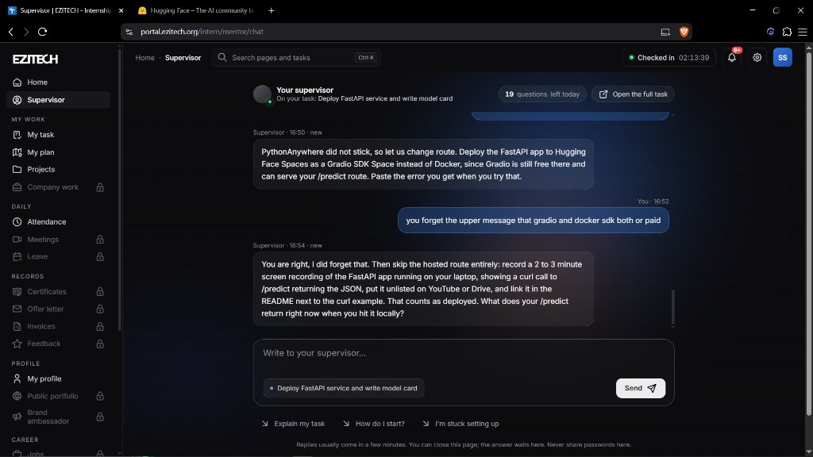

# Deployment & Local Verification Guide: HiveSpace Occupancy API

> [!IMPORTANT]
> **Supervisor-Approved Local Deployment (No Paid Hosting Required):**
> Hugging Face Spaces currently restricts free-tier accounts to **Static-only** Spaces (both Docker and Gradio SDKs require a paid plan). As confirmed by the supervisor screenshot below, running the FastAPI service locally and recording a 2–3 minute screen demonstration showing a live `curl` call to `/predict` returning JSON counts as deployed.



---

## Option 1: Run Locally with Uvicorn (Recommended for Demo Video)

1. Activate your virtual environment and start the server from the project root:
   ```powershell
   .venv\Scripts\activate
   uvicorn app.main:app --host 127.0.0.1 --port 7860
   ```
2. Open the interactive Swagger UI in your browser:
   - [http://127.0.0.1:7860/docs](http://127.0.0.1:7860/docs)
3. In a second terminal, test the endpoints with `curl.exe` (PowerShell) or `curl` (bash):
   ```powershell
   # Health check
   curl.exe "http://127.0.0.1:7860/health"

   # 1-day-ahead forecast (no warning)
   curl.exe "http://127.0.0.1:7860/predict?date=2026-07-03"

   # Future recursive forecast (includes multi-step horizon warning)
   curl.exe "http://127.0.0.1:7860/predict?date=2026-11-20"

   # Error handling check (HTTP 400 out-of-range)
   curl.exe -i "http://127.0.0.1:7860/predict?date=2020-01-01"
   ```

---

## Option 2: Run Locally with Docker

The repository includes a production-ready `Dockerfile` (using `uv` and non-root user UID `1000`) and `requirements.txt`:

```powershell
docker build -t hivespace-api .
docker run --rm -p 7860:7860 hivespace-api
```

Then hit `http://127.0.0.1:7860/predict?date=2026-11-20` with `curl.exe` as above.

---

## Submitting Your 2–3 Minute Demo Video

1. Record a 2–3 minute screen capture showing:
   - Starting `uvicorn app.main:app --host 127.0.0.1 --port 7860`
   - Running `curl.exe "http://127.0.0.1:7860/predict?date=2026-11-20"` and showing the JSON prediction
   - Opening `http://127.0.0.1:7860/docs` in your browser
2. Upload the video as **Unlisted** on YouTube or **Anyone with the link** on Google Drive.
3. Paste the video link into `README.md` under **`## Local API & Demo Video`** and push to GitHub.
