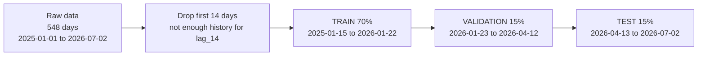
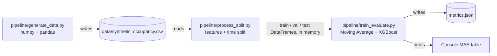

# HiveSpace Desk Occupancy — Data Foundation

> Synthetic daily desk-occupancy data, a leakage-safe feature pipeline, and two baseline forecasting models (Moving Average and XGBoost) for HiveSpace.

  

> [!NOTE]
> All data in this repository is **synthetic**. The scores below show that the pipeline works. They do not show how the models would perform on real HiveSpace data.

**Contents:** [Problem](#problem-and-solution) · [Quick start](#quick-start) · [Data Split Strategy](#data-split-strategy) · [Architecture](#architecture) · [Results](#results) · [Testing](#testing) · [Limitations](#known-limitations-and-next-steps)

---

## Problem and solution

HiveSpace wants to forecast how many desks will be used each day, but it has no historical data yet. Time-series machine learning also has a common trap: **data leakage**, where the model accidentally sees "future" information during training and looks better than it really is.

This project solves both problems:

1. **Generates** 548 days (18 months) of realistic synthetic occupancy data with weekly seasonality and random noise.
2. **Builds features** that only look at the past (lag and rolling features).
3. **Splits the data by time** (train → validation → test) without any shuffling.
4. **Trains and compares** a Moving Average baseline and an XGBoost regressor, and saves the MAE scores to `metrics.json`.

## Features

- Reproducible data generation (fixed random seed `42`): every run creates the same 548 rows.
- Past-only features: `lag_1`, `lag_7`, `lag_14`, `rolling_mean_7`, `rolling_std_7`, `day_of_week`, `is_weekend`.
- Strict chronological 70 / 15 / 15 split with automatic integrity checks that stop the run if the order is ever broken.
- Clear error messages for missing files, missing columns, or invalid dates.
- MAE comparison printed to the console and saved to `metrics.json`, together with the date range of each split.

## Tech stack

Only the libraries approved in [libraries.md](libraries.md) are used:

| Library | Why it is used |
| --- | --- |
| **pandas** | Loading CSV data, `shift()`/`rolling()` feature engineering, date-ordered slicing |
| **numpy** | Weekly pattern arrays and seeded random noise |
| **xgboost** | `XGBRegressor`, the main forecasting model |
| **scikit-learn** | `mean_absolute_error` for consistent evaluation |

The Python standard library (`pathlib`, `json`) handles file paths and JSON output.

---

## Quick start

**Prerequisites:** Python 3.10+ and [uv](https://docs.astral.sh/uv/) (or plain `pip`).

```powershell
# 1. Create a virtual environment and install the approved libraries
uv venv .venv
uv pip install --python .venv pandas numpy xgboost scikit-learn

# 2. Activate it (Windows PowerShell)
.venv\Scripts\activate
#    macOS / Linux:  source .venv/bin/activate

# 3. Run the pipeline in order (from the project root)
python pipeline/generate_data.py    # creates data/synthetic_occupancy.csv
python pipeline/process_split.py    # shows the split report and runs the leakage checks
python pipeline/train_evaluate.py   # trains both models and writes metrics.json
```

Example output of `process_split.py`:

```text
Chronological split (no shuffling):
Train        373 rows  2025-01-15 -> 2026-01-22
Validation    80 rows  2026-01-23 -> 2026-04-12
Test          81 rows  2026-04-13 -> 2026-07-02
Features: lag_1, lag_7, lag_14, rolling_mean_7, rolling_std_7, day_of_week, is_weekend
Integrity check passed: train < validation < test, no overlapping dates.
```

---

## Data Split Strategy

This section explains **how the data is split** and **why no future information can leak** into training.

### 1. Why we do not split randomly

With a normal `train_test_split(shuffle=True)`, a training row from **May** could sit next to a test row from **April**. The model would then learn from the "future" and get a misleadingly good score. In real use we always predict **tomorrow using only the past**, so the evaluation must copy that exact situation.

### 2. The chronological split

After features are built, the rows are **sorted by date** and cut into three blocks, in order:

| Split | Share | Rows | Date range | Purpose |
| --- | --- | --- | --- | --- |
| **Train** | 70% | 373 | 2025-01-15 → 2026-01-22 | The model learns from these days only |
| **Validation** | 15% | 80 | 2026-01-23 → 2026-04-12 | Checks and tunes the models on unseen days |
| **Test** | 15% | 81 | 2026-04-13 → 2026-07-02 | Final, untouched "future" used for the reported score |



Time only moves forward: every training date comes before every validation date, and every validation date comes before every test date.

### 3. How the features avoid leakage

Every feature for day **t** is built from days **before t**:

| Feature | pandas code | Uses days |
| --- | --- | --- |
| `lag_1` | `occupancy.shift(1)` | t-1 |
| `lag_7` | `occupancy.shift(7)` | t-7 (same weekday last week) |
| `lag_14` | `occupancy.shift(14)` | t-14 |
| `rolling_mean_7` | `occupancy.shift(1).rolling(7).mean()` | t-7 … t-1 |
| `rolling_std_7` | `occupancy.shift(1).rolling(7).std()` | t-7 … t-1 |
| `day_of_week`, `is_weekend` | from the date | known in advance (calendar) |

The key detail is that `shift(1)` comes **before** `rolling(7)`. Without it, the 7-day window would include day t itself, and the model would be given the answer.

The first 14 rows have no full history, so they are **dropped instead of filled**. Filling them (for example with an overall mean) would mix information from the whole dataset into the early rows.

> [!NOTE]
> The first validation day's `lag_1` is the last training day's occupancy. This is **not** leakage, because the past is always known when you forecast tomorrow. Leakage only happens when information flows backwards in time.

### 4. How the integrity is proven

- **Automatic checks on every run.** `check_split_integrity()` in [process_split.py](pipeline/process_split.py) stops with an error unless each split is in date order and `train.max_date < validation.min_date` and `validation.max_date < test.min_date`.
- **Audit trail.** `metrics.json` stores the row count and the start and end date of every split, so a reviewer can confirm the order without running code.
- **Perturbation test.** During development we changed day t's occupancy to `999` and confirmed that day t's features stayed exactly the same, while day t+1's `lag_1` became `999`. This shows the features only ever look backwards.
- **Train-only fitting.** XGBoost is fitted on the train split only. Validation and test rows are used for prediction only.

---

## Architecture

The project is three standalone scripts run in order. Each has one job.



| File | Responsibility |
| --- | --- |
| [pipeline/generate_data.py](pipeline/generate_data.py) | Builds the 548-day series: weekday base values (busy Tue–Thu, quiet weekends) × a gentle yearly wave + Gaussian noise (std 6), clipped to 0–100 whole desks. |
| [pipeline/process_split.py](pipeline/process_split.py) | Validates the CSV, adds the past-only features, splits by time, and checks split integrity. Can run on its own or be imported. |
| [pipeline/train_evaluate.py](pipeline/train_evaluate.py) | Imports `load_and_split()`, scores the 7-day Moving Average baseline, trains `XGBRegressor(n_estimators=200, max_depth=3, learning_rate=0.05)`, and saves MAE scores. |
| `data/synthetic_occupancy.csv` | Raw data: `date`, `occupancy`. |
| `metrics.json` | MAE scores, split date ranges, and feature list. |

The splits are passed in memory (by importing `process_split`) rather than saved as extra CSV files. This keeps the repository matching the approved layout in `folder.md`.

---

## Results

MAE = the average number of desks a prediction is off by (lower is better). These are the scores from `metrics.json`:

| Model | Validation MAE | Test MAE |
| --- | --- | --- |
| Moving Average (7-day) | 26.73 | 23.27 |
| **XGBoost** | **5.30** | **6.52** |

**Why the baseline is so much worse:** a 7-day average predicts about the same value (~49 desks) every day. It therefore misses the weekly shape badly, with Wednesday at ~80 desks and Sunday at ~5. XGBoost can use `lag_7` and `day_of_week` to learn that shape. Its remaining error (~6 desks) is close to the random noise built into the data (std 6), which is about the best any model can do here.

---

## Testing

Running the three commands in [Quick start](#quick-start) is the end-to-end (black-box) test. `process_split.py` also runs the integrity checks every time.

During development these checks were run and passed (14 `unittest` cases, standard library only):

- **Generator:** 548 rows, values within 0–100, no missing values, weekdays clearly busier than weekends, identical output on every run.
- **Leakage:** changing day t's target does not change day t's features; lag and rolling values match a manual lookup; the first 14 rows are dropped.
- **Split:** the three splits are in date order with no overlapping dates; shuffled input is re-sorted correctly; overlapping splits are rejected.
- **Input validation:** clear errors for a missing file, a missing column, or an invalid date.
- **Metrics:** all MAE values are positive floats, and XGBoost beats the baseline on the test split.

A missing input file gives a clear message:

```text
Error: Raw data not found at ...\data\synthetic_occupancy.csv. Run `python pipeline/generate_data.py` first.
```

## Configuration and security

- No API keys, secrets, or network calls are used. Everything runs locally.
- File paths are resolved from each script's own location with `pathlib`, so scripts work from any working directory.
- Outputs are plain CSV and JSON. No pickle files are created or loaded.
- Settings (start date, number of days, seed, lag days, split shares, model settings) are named constants at the top of each script.

## Known limitations and next steps

- **Synthetic data only.** Real occupancy will include holidays, events, and trend changes that this generator does not model.
- **One-day-ahead forecasts.** `lag_1` assumes yesterday's value is known. Forecasting a week ahead would need features that use only days t-7 and older.
- **No hyperparameter tuning yet.** The validation split is ready for it. The test split should stay untouched until a final model is chosen.
- **Possible next steps:** add holiday flags, try a seasonal-naive baseline (`lag_7`), and add time-series cross-validation.

## Project structure

```text
├── data/
│   └── synthetic_occupancy.csv
├── pipeline/
│   ├── generate_data.py
│   ├── process_split.py
│   └── train_evaluate.py
├── metrics.json
├── libraries.md
└── README.md
```

## License

No license has been chosen yet. Until a `LICENSE` file is added, all rights are reserved by the author.
